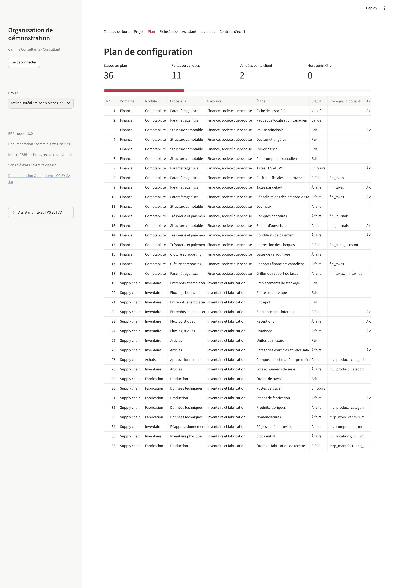
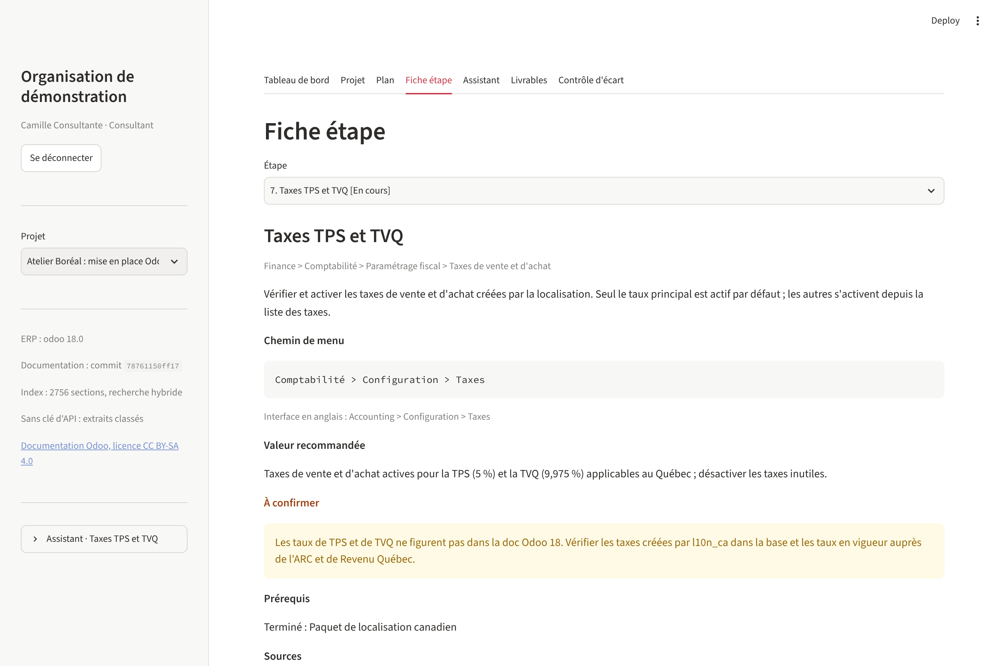
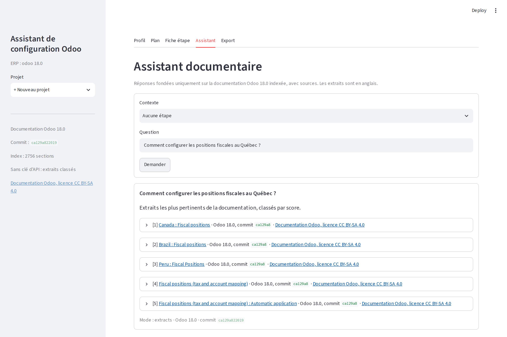
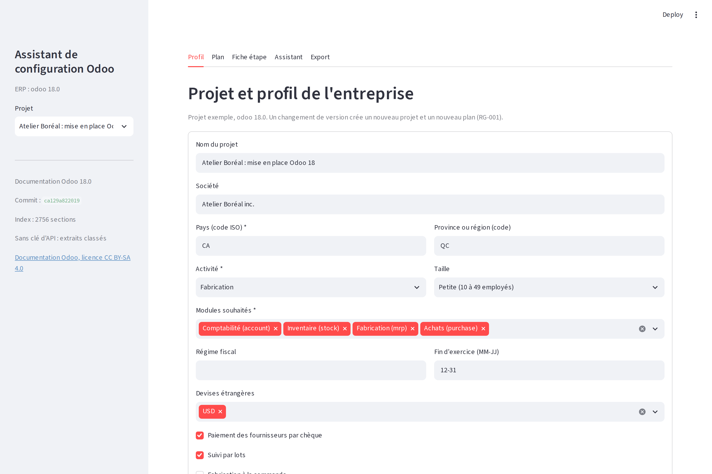

# Assistant de configuration Odoo 18

> **In short (EN).** A working V0 of an Odoo 18 configuration assistant. A consultant enters a
> company profile; the app builds a configuration plan ordered by prerequisites, shows one sheet
> per step (goal, menu path, recommended value, sources), tracks progress, answers questions with
> citations from the official Odoo documentation, and exports a configuration workbook to Excel.
> Two journeys: Finance for a Quebec company (GST/QST) and Inventory and manufacturing for a small
> manufacturer. Every step is checked against the odoo/documentation 18.0 repository by tests.

[](https://github.com/kamilbbm/odoo-config-assistant/actions/workflows/ci.yml)

## Le problème

Configurer Odoo pour un domaine complet, par exemple la comptabilité d'une société québécoise,
demande de connaître l'ordre des étapes, leurs dépendances et les obligations locales. La
documentation éditeur est organisée par application, pas par métier. Ce savoir reste dans la tête
des consultants : il n'est ni capitalisé ni outillé, et chaque projet le reconstitue.

Ce dépôt est la V0 d'un outil qui structure ce savoir en parcours vérifiables, rattachés à la
documentation officielle, et qui produit un paramétrage documenté et traçable. La spécification
fonctionnelle complète (V1 cible) est dans [docs/SFD.md](docs/SFD.md).

## Démo

Projet exemple fictif : Atelier Boréal inc., PME manufacturière au Québec
([projects/exemple.json](projects/exemple.json)).

| Plan de configuration | Fiche étape |
| --- | --- |
|  |  |
| **Assistant documentaire** | **Profil de l'entreprise** |
|  |  |

Les captures sont produites par `scripts/capture_screens.py` (workflow `Screenshots`).

## Démo en ligne

URL : _à compléter après le déploiement_ (`https://<nom-de-l-app>.streamlit.app`)

L'application est prête pour [Streamlit Community Cloud](https://streamlit.io/cloud) :

1. New app, dépôt `kamilbbm/odoo-config-assistant`, branche `main`, fichier principal
   `app/streamlit_app.py`, Python 3.11 ou plus récent.
2. Facultatif : dans Advanced settings, Secrets, ajouter `ANTHROPIC_API_KEY = "..."` pour les
   réponses rédigées. Sans clé, l'assistant affiche les extraits classés.
3. Déployer. Au premier démarrage, l'application télécharge les pages RST de la documentation
   Odoo 18.0 (environ 16 Mo) et construit l'index, en quelques secondes ; le résultat est gardé
   en cache (`st.cache_resource`) pour la durée de vie de l'instance.

Les dépendances viennent de [requirements.txt](requirements.txt) et `git` de
[packages.txt](packages.txt). Sur Community Cloud, le disque n'est pas persistant : les projets
créés en ligne disparaissent au redémarrage de l'instance, seul le projet exemple est permanent.
Le job CI `app-smoke` reproduit ce démarrage sur un dépôt neuf et échoue si les logs du serveur
contiennent une erreur ou un avertissement.

## Ce que fait la V0

- **Profil de l'entreprise** : pays, province, activité, taille, modules souhaités, options
  (devises étrangères, chèques, lots, fabrication à la commande).
- **Plan ordonné** : filtrage des étapes applicables au profil, tri topologique des prérequis,
  détection des cycles et des prérequis inexistants au chargement du référentiel.
- **Deux parcours, 37 étapes** dans [data/journeys](data/journeys) :
  - Finance, société québécoise (18 étapes) : localisation canadienne, TPS et TVQ, positions
    fiscales par province, plan comptable, journaux, comptes bancaires, soldes d'ouverture,
    exercice fiscal, devise, conditions de paiement, chèques, verrouillage, rapports.
  - Inventaire et fabrication (19 étapes) : entrepôt et emplacements, routes, réceptions et
    livraisons, unités de mesure, catégories et valorisation, composants achetés, lots, postes de
    travail, nomenclatures, réapprovisionnement, fabrication à la commande, stock initial, ordre
    de fabrication de recette.
- **Fiche étape** : objectif, chemin de menu Odoo 18, valeur recommandée selon le profil,
  prérequis (terminés, bloquants, hors plan), sources avec lien et licence, statut, valeur
  retenue, commentaire.
- **Suivi des statuts** : À faire, En cours, Fait, Validé, Hors périmètre.
- **Assistant documentaire** : recherche BM25 dans la documentation Odoo 18.0 indexée par section.
  Sans clé d'API, il affiche les extraits classés avec leur source. Si `ANTHROPIC_API_KEY` est
  défini, un modèle Claude rédige la réponse à partir des seuls extraits retrouvés ; une réponse
  qui ne cite aucun extrait est rejetée. Une question non couverte reçoit une réponse explicite
  « non couverte par la documentation ».
- **Cahier de paramétrage Excel** : une ligne par étape, statut, valeur recommandée, colonne
  « À confirmer », valeur retenue, commentaire, sources, commit de la documentation.

### Véracité du contenu

Le contenu des parcours vient de la documentation officielle (dépôt
[odoo/documentation](https://github.com/odoo/documentation), branche 18.0), pas de la mémoire
d'un consultant ou d'un modèle :

- chaque étape cite au moins une page RST, avec son ancre et son URL publique ;
- les tests vérifient, dans le clone de la documentation, que la page existe, que l'ancre y est
  déclarée, que le titre correspond et que le chemin de menu y figure mot pour mot ;
- une valeur que la documentation ne confirme pas (taux de TPS et de TVQ, périodicité des
  déclarations, conditions de paiement, choix selon la taille de l'entreprise) est marquée
  `verified: false` avec une note, et s'affiche avec le badge « À confirmer » ;
- le commit de la documentation est conservé sur chaque étape, chaque réponse et dans le cahier.

Les chemins de menu sont en anglais, tels qu'écrits dans la documentation, pour rester
vérifiables. Les libellés français viendront des fichiers de traduction .po (feuille de route).

## Lancer la démo

Python 3.11 ou plus récent, depuis la racine du dépôt (un environnement virtuel est conseillé) :

```bash
pip install -e .
```

```bash
python scripts/fetch_docs.py
```

```bash
python scripts/build_index.py
```

```bash
streamlit run app/streamlit_app.py
```

`fetch_docs.py` télécharge les pages RST de la documentation (clone partiel, environ 16 Mo ;
`--full` pour le dépôt complet) dans `vendor/`, qui n'est pas versionné. Les deux scripts sont
facultatifs : si l'index est absent, l'application le construit à son premier démarrage. Pour activer les réponses rédigées, copier `.env.example` en `.env` ou
exporter `ANTHROPIC_API_KEY` ; l'application fonctionne sans.

Tests et contrôle du code :

```bash
pip install -e ".[dev]" && ruff check . && pytest
```

Les tests de véracité sont ignorés proprement tant que la documentation n'est pas téléchargée.

## Architecture

Modules, flux et choix techniques : [docs/architecture.md](docs/architecture.md).

```
data/journeys/*.yaml   référentiel de parcours (validé au chargement)
src/odoo_config_assistant/
  models.py            Profile, Step, Journey, Project, StepStatus (pydantic)
  journeys.py          chargement et validation du YAML
  engine.py            plan, tri topologique, statuts et règles de gestion
  knowledge.py         découpage RST, index BM25, citations
  assistant.py         réponse avec ou sans modèle de langage
  export.py            cahier de paramétrage Excel
  storage.py           un fichier JSON par projet
  sources.py           téléchargement de la documentation et construction de l'index
scripts/               fetch_docs.py, build_index.py, smoke_app.py, capture_screens.py
app/streamlit_app.py   interface en français
```

## Règles de gestion couvertes

Codes de la SFD (section 3.4). Chaque règle a des tests nommés d'après son code.

| Règle | Énoncé (résumé) | Tests |
| --- | --- | --- |
| RG-001 | Un projet = un ERP et une version ; un changement de version crée un nouveau plan | `tests/test_engine.py::test_rg001_*` |
| RG-002 | Pas de plan si pays, activité ou modules manquent ; champs manquants listés | `tests/test_engine.py::test_rg002_*` |
| RG-003 | Fait seulement si les prérequis sont Fait ou Validé ; sinon refus avec la liste | `tests/test_engine.py::test_rg003_*` |
| RG-005 | Le profil modifié recalcule le plan ; étapes faites conservées, non applicables en Hors périmètre | `tests/test_engine.py::test_rg005_*` |
| RG-006 | Toute réponse cite au moins une source, sinon « non couverte » | `tests/test_knowledge.py::test_rg006_*` |
| RG-007 | Seules les sources de la version du projet sont utilisées | `tests/test_knowledge.py::test_rg007_*` |
| RG-008 | Réponses et fiches conservent le commit de la documentation | `tests/test_engine.py::test_rg008_*`, `tests/test_knowledge.py::test_rg008_*` |
| RG-012 | Une étape sans source est rejetée au chargement du référentiel | `tests/test_journeys.py::test_rg012_*` |
| RG-014 | Toute citation affiche le lien vers la page source et la licence CC BY-SA 4.0 | `tests/test_knowledge.py::test_rg014_*`, `tests/test_journeys_data.py::test_rg014_*` |

## Feuille de route V1

La V1 cible est décrite dans la [SFD](docs/SFD.md). Hors périmètre de la V0 :

- rôles, authentification et accès par projet (F-001, RG-004, RG-015) ;
- synchronisation planifiée de la documentation, versions candidate et active, contrôles de
  publication (F-002, RG-009, ERR-003 à ERR-008) ;
- recomposition française des pages et des libellés de menus depuis les fichiers .po (F-003,
  RG-010) ;
- alertes lorsqu'une page source d'une étape change (F-013, RG-011) ;
- recherche sémantique en complément du BM25, derrière l'interface `Retriever` de `knowledge.py` ;
- base de données applicative, éditeur de parcours et référentiel Domaine, Module, Processus,
  Paramètre (F-004, F-005, E-09) ;
- identité de l'organisation sur les livrables, checklist et modèles d'import (F-012, RG-013) ;
- contrôle d'écart avec une instance Odoo en lecture seule (phase 2, F-014, RG-016) ;
- autres ERP (Q-012).

## Licence et attribution

- Code : licence MIT, voir [LICENSE](LICENSE).
- Documentation Odoo : CC BY-SA 4.0, Odoo S.A. et contributeurs. Elle n'est pas copiée dans ce
  dépôt ; elle est téléchargée par `scripts/fetch_docs.py`. Détails dans [NOTICE.md](NOTICE.md).
- Odoo est une marque d'Odoo S.A. Ce projet est indépendant.
- Toutes les données de démonstration sont fictives.

## Auteur

Kamil Baba-Moussa, consultant ERP (Odoo, Infor M3, SAP S/4HANA), Montréal.
