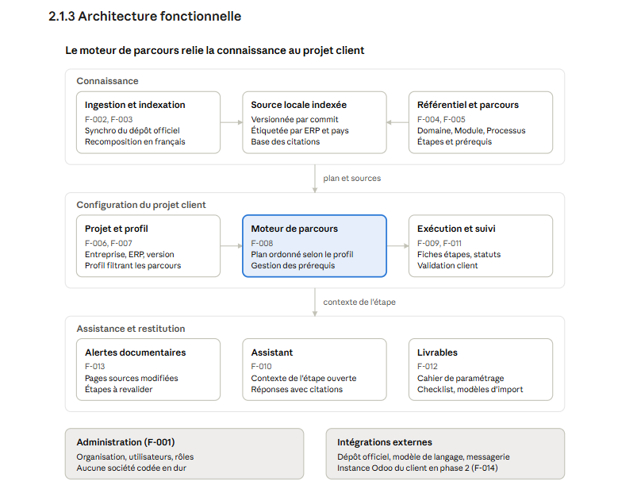
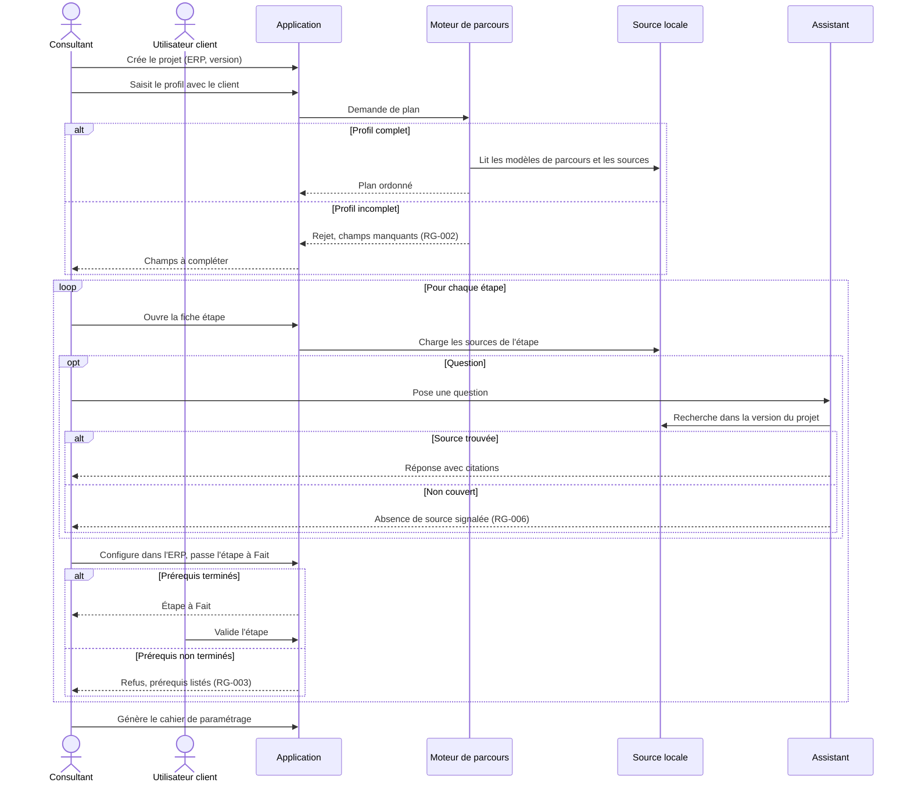
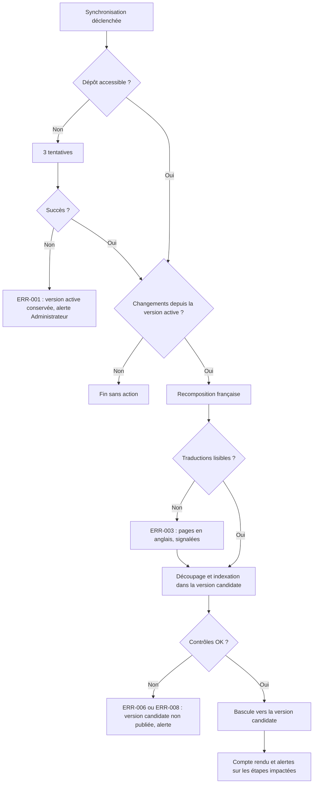

# SFD Assistant de configuration ERP

Oct 30, 2026 · @Kamil

| Champ | Valeur |
| --- | --- |
| Projet | Assistant de configuration ERP |
| Client | Organisation utilisatrice (définie en configuration) |
| Fonctionnalité | Application web de configuration guidée, ERP 1 : Odoo 18 |
| Version | 0.1 du 30/10/2026 |
| Statut | Brouillon |
| Auteur | Kamil BM |
| Contributeurs | À définir |
| Approbateurs | À définir |

| Version | Date | Auteur | Modifications |
| --- | --- | --- | --- |
| 0.1 | 30/10/2026 | Roy | Création initiale : sections 1 et plan |

## 1. Introduction

### 1.1 Contexte

Le projet Assistant de configuration ERP s'inscrit dans l'activité d'intégration et de TMA Odoo de l'organisation utilisatrice, dont l'identité est définie en configuration. Il vise à industrialiser le paramétrage initial et l'évolution de la configuration des ERP clients.

Actuellement, la configuration d'Odoo repose sur l'expertise individuelle des consultants et sur une documentation éditeur organisée par application, non par métier. Le paramétrage d'un domaine complet (par exemple la comptabilité d'une société française) suppose de connaître l'ordre des étapes, leurs dépendances et les obligations légales locales. Ce savoir n'est ni capitalisé ni outillé.

Cette spécification couvre une application web qui guide l'utilisateur dans la configuration de sa société par domaine métier, à partir d'un profil d'entreprise, en s'appuyant sur la documentation officielle Odoo 18 comme source de référence. La première version cible un seul ERP (Odoo 18) et l'architecture doit permettre d'en ajouter d'autres. Sont exclus de la V1 : l'écriture automatique de la configuration dans l'instance Odoo du client, la migration de données et le support des versions Odoo antérieures à la 18.

**Inclus** :

- Base de connaissances construite à partir de la documentation Odoo 18, indexée par application, domaine métier et pays
- Source documentaire locale synchronisée depuis le dépôt officiel, versionnée et administrable (rafraîchissement, historique, sources complémentaires)
- Référentiel métier structuré en Domaine, Module, Processus et Paramètre (Finance, Ventes, Services, Supply chain, RH, Marketing et Site web)
- Questionnaire de profil entreprise (pays, activité, taille, régime fiscal, modules souhaités)
- Moteur de parcours générant un plan de configuration ordonné avec ses prérequis
- Assistant conversationnel répondant aux questions avec citation des sources
- Suivi d'avancement du parcours par projet client
- Génération de livrables : cahier de paramétrage, checklist de configuration, modèles de fichiers d'import
- Paramétrage de l'organisation utilisatrice (nom, logo, rôles, mentions) en configuration, aucune société n'étant codée en dur
- Lecture de la configuration d'une instance Odoo pour contrôle d'écart (phase 2)

Parties prenantes :

- Direction de l'organisation : sponsor, arbitrage du périmètre et des priorités
- Consultants fonctionnels : utilisateurs principaux, production des cahiers de paramétrage
- Clients PME (dirigeant, comptable, responsable métier) : utilisateurs en mode guidé, validation des choix de configuration
- Équipe TMA : contrôle et évolution des configurations existantes
- Référent contenu : maintien du référentiel métier et des parcours, validation des mises à jour documentaires
- Équipe technique : conception, développement et exploitation de l'application

Environnement technique concerné :

| Système | Rôle dans la solution | Phase |
| --- | --- | --- |
| Odoo 18 (Online, Odoo.sh ou sur site) | ERP cible de la configuration | V1 (référence), phase 2 (connexion) |
| Dépôt GitHub odoo/documentation, branche 18.0 | Source documentaire officielle : pages RST en anglais et traductions françaises (.po), licence CC BY-SA, synchronisée dans une source locale | V1 |
| Application web Assistant ERP | Interface de parcours, assistant, suivi et livrables | V1 |
| Base de données applicative | Projets clients, profils, référentiel métier, avancement | V1 |
| Index de recherche sémantique | Recherche dans la base de connaissances | V1 |
| Service de modèle de langage | Génération des réponses de l'assistant | V1 |
| API externe Odoo (XML-RPC ou JSON-RPC) | Lecture de la configuration de l'instance client | Phase 2 |

### 1.2 Objectif de la solution

Permettre à un consultant ou à une entreprise de configurer son ERP domaine par domaine, selon un parcours ordonné adapté à son profil et justifié par la documentation officielle. La solution réduit la dépendance à l'expertise individuelle et produit un paramétrage documenté et traçable.

## 2. Description fonctionnelle

### 2.1 Présentation fonctionnelle de la solution

#### 2.1.1 Vue d'ensemble

L'application organise la configuration d'un ERP en parcours métier. Un projet client est créé pour une entreprise et un ERP donné (Odoo 18 en V1). Le profil de l'entreprise (pays, activité, taille, régime fiscal, modules souhaités) détermine les parcours applicables, par exemple Finance pour une société française de prestation de services.

Chaque parcours se décline en étapes ordonnées avec leurs prérequis. Une fiche étape indique l'objectif, le chemin de menu dans l'ERP, la valeur recommandée selon le profil et les sources documentaires. L'assistant conversationnel répond aux questions dans le contexte de l'étape, en citant la documentation. L'avancement est suivi étape par étape jusqu'à la production du cahier de paramétrage.

La connaissance repose sur deux couches distinctes. La source documentaire locale, synchronisée depuis le dépôt officiel, fournit le contenu de référence. Le référentiel métier, maintenu par le référent contenu, structure ce contenu en Domaine, Module, Processus et Paramètre, et définit les parcours. Quatre rôles utilisent l'application : Administrateur, Référent contenu, Consultant et Utilisateur client.

#### 2.1.2 Fonctionnalités principales

| ID | Fonctionnalité | Description | Acteurs | Fréquence |
| --- | --- | --- | --- | --- |
| F-001 | Configuration de l'organisation | Paramétrage de l'identité (nom, logo, mentions), des utilisateurs et des rôles | Administrateur | À l'installation, puis ponctuel |
| F-002 | Gestion des sources documentaires | Déclaration d'une source (dépôt, branche, langue), synchronisation, historique des versions | Administrateur, Référent contenu | Hebdomadaire automatique, ou ponctuel |
| F-003 | Ingestion et indexation | Recomposition des pages en français, découpage par section, étiquetage (ERP, version, application, pays, modules), indexation | Système | À chaque synchronisation |
| F-004 | Gestion du référentiel métier | Maintien de l'arborescence Domaine, Module, Processus, Paramètre et rattachement aux sources | Référent contenu | Ponctuel |
| F-005 | Gestion des modèles de parcours | Définition des étapes, de leur ordre, des prérequis et des conditions d'application selon le profil | Référent contenu | Ponctuel |
| F-006 | Gestion des projets clients | Création d'un projet (entreprise, ERP, version), affectation des membres | Consultant | Ponctuel |
| F-007 | Questionnaire de profil entreprise | Saisie du profil qui conditionne les parcours et les valeurs recommandées | Consultant, Utilisateur client | À la création du projet, puis ponctuel |
| F-008 | Génération du plan de configuration | Calcul du plan ordonné à partir du profil et des modèles de parcours | Système | À chaque validation ou modification du profil |
| F-009 | Exécution guidée | Fiche étape : objectif, chemin de menu, valeur recommandée, sources, statut | Consultant, Utilisateur client | Continu |
| F-010 | Assistant conversationnel | Réponses contextualisées à l'étape, fondées sur la source locale, avec citations | Tous | Ponctuel |
| F-011 | Suivi et validation | Statut par étape (À faire, En cours, Fait, Validé), commentaires, validation client | Consultant, Utilisateur client | Continu |
| F-012 | Génération des livrables | Cahier de paramétrage, checklist de configuration, modèles de fichiers d'import | Consultant | Ponctuel |
| F-013 | Alertes de mise à jour documentaire | Notification lorsqu'une page source d'une étape change entre deux versions | Système | À chaque synchronisation |
| F-014 | Contrôle d'écart avec l'instance (phase 2) | Lecture de la configuration réelle et comparaison avec le plan | Consultant | Ponctuel |

#### 2.1.3 Architecture fonctionnelle

La couche Connaissance fournit le plan et les sources au projet client ; l'étape ouverte donne son contexte à l'assistant, aux livrables et aux alertes. L'administration et les intégrations externes servent l'ensemble des couches.

#### 2.1.4 Interfaces utilisateur

| ID | Écran | Description | Utilisateurs |
| --- | --- | --- | --- |
| E-01 | Tableau de bord | Liste des projets, avancement global par projet et par domaine | Consultant, Utilisateur client |
| E-02 | Projet et profil entreprise | Informations du projet et questionnaire de profil | Consultant, Utilisateur client |
| E-03 | Plan de configuration | Étapes par domaine et module, statuts, prérequis bloquants | Consultant, Utilisateur client |
| E-04 | Fiche étape | Détail du paramétrage, sources citées, commentaires, validation | Consultant, Utilisateur client |
| E-05 | Assistant | Panneau conversationnel accessible depuis toutes les pages, contextualisé à l'étape ouverte | Tous |
| E-06 | Livrables | Génération et export des livrables du projet | Consultant |
| E-07 | Administration de l'organisation | Identité, utilisateurs, rôles | Administrateur |
| E-08 | Administration des sources | Sources déclarées, synchronisations, version en cours, état de l'indexation, anomalies | Administrateur, Référent contenu |
| E-09 | Référentiel et parcours | Arborescence métier, éditeur de parcours, étapes impactées par une mise à jour | Référent contenu |

#### 2.1.5 Points d'intégration

| Système | Sens | Mode | Données échangées | Fréquence | Phase |
| --- | --- | --- | --- | --- | --- |
| Dépôt GitHub odoo/documentation | Entrant | Git (clone puis mise à jour) | Pages RST, traductions .po, identifiant de version | Hebdomadaire, ou ponctuel | V1 |
| Service de modèle de langage | Aller et retour | API | Question et extraits documentaires, réponse générée | Ponctuel | V1 |
| Service de vectorisation | Aller et retour | API | Extraits documentaires, vecteurs de recherche | À chaque synchronisation | V1 |
| Messagerie | Sortant | SMTP | Alertes de mise à jour, invitations, validations | À chaque événement | V1 |
| Fournisseur d'identité de l'organisation | Entrant | OIDC ou SAML | Identité et groupes des utilisateurs | À chaque connexion | V1, optionnel |
| Instance Odoo du client | Entrant | API externe Odoo, lecture seule | Sociétés, modules installés, taxes, journaux, comptes | Ponctuel | Phase 2 |

## 3. Processus fonctionnel

### 3.1 Vue d'ensemble du flux

#### 3.1.1 Description du flux

Le flux principal suit la vie d'un projet client. Le consultant crée le projet en choisissant l'ERP et sa version, puis renseigne le profil de l'entreprise avec l'utilisateur client. Dès que le profil est complet, le moteur de parcours génère le plan de configuration ordonné, limité aux domaines et modules retenus.

Le projet avance ensuite étape par étape. Pour chaque étape, la fiche indique quoi paramétrer, où et avec quelle valeur recommandée. La saisie reste faite par l'utilisateur dans l'ERP, l'application n'écrivant jamais dans l'instance. L'étape passe à Fait une fois ses prérequis terminés, puis l'utilisateur client la valide. L'assistant répond aux questions à tout moment, dans le contexte de l'étape ouverte. Le projet se conclut par la génération du cahier de paramétrage.

Un second flux, documentaire, tourne en arrière-plan. La synchronisation périodique met à jour la source locale et signale les étapes dont la documentation a changé. Il est décrit en 3.3.

#### 3.1.2 Diagramme de séquence du flux

### 3.2 Présentation globale du processus métier

1. Le consultant crée le projet client et choisit l'ERP et sa version (F-006).
2. Le consultant et l'utilisateur client renseignent le profil de l'entreprise (F-007).
3. Le moteur génère le plan de configuration ordonné par domaine et module (F-008).
4. Pour chaque étape, l'utilisateur consulte la fiche et paramètre l'ERP selon la valeur recommandée (F-009).
5. L'assistant répond aux questions avec les sources citées (F-010).
6. L'étape passe à Fait, puis l'utilisateur client la valide (F-011).
7. Une fois les étapes validées, le consultant génère le cahier de paramétrage et la checklist (F-012).

### 3.3 Présentation globale du processus de synchronisation documentaire

#### 3.3.1 Processus de transfert

**Flux : Dépôt odoo/documentation → Synchronisation → Recomposition française → Indexation → Publication**

**Étape 1 : Récupération du dépôt** L'application récupère la branche déclarée (18.0) du dépôt officiel : clone complet à la création de la source, mise à jour ensuite. L'identifiant du commit récupéré est enregistré comme version candidate.

**Étape 2 : Détection des changements** La version candidate est comparée à la version active. La liste des pages ajoutées, modifiées et supprimées est établie. Sans changement, le traitement s'arrête.

**Étape 3 : Recomposition française** Chaque page modifiée est reconstruite en français à partir des fichiers de traduction. Les passages non traduits restent en anglais et sont comptés par page.

**Étape 4 : Découpage, étiquetage et indexation** Les pages sont découpées par section, étiquetées (ERP, version, application, pays, modules, libellés de menus) et indexées dans la version candidate, sans toucher à la version active.

**Étape 5 : Contrôle, publication et alertes** Si tous les contrôles sont OK, la version candidate devient la version active en une seule bascule. Un compte rendu est envoyé au référent contenu, avec les étapes de parcours dont une page source a changé (F-013). En cas d'échec, la version active reste en service.

#### 3.3.2 Format des fichiers sources

| Élément | Type de données | Obligatoire | Format | Exemple |
| --- | --- | --- | --- | --- |
| Page de documentation | Texte balisé | Oui | reStructuredText (.rst) | content/applications/finance/fiscal\_localizations/france.rst |
| Fichier de traduction | Texte | Oui pour le français | gettext (.po), un fichier par domaine | locale/fr/LC\_MESSAGES/finance.po |
| Référence de segment traduit | Texte | Oui | Chemin de la page et numéro de ligne | france.rst:92 |
| Identifiant de version | Texte | Oui | Identifiant de commit Git, 40 caractères | b892c0d5a9ca… |
| Branche | Texte | Oui | Nom de branche | 18.0 |
| Libellé d'interface | Texte | Non | Rôle guilabel | France - Accounting |
| Module technique | Texte | Non | Nom technique entre accents graves | l10n\_fr\_account |

Caractéristiques techniques constatées le 30/10/2026 sur la branche 18.0 :

| Caractéristique | Valeur |
| --- | --- |
| Encodage | UTF-8 |
| Volume | 1 065 pages RST, 15 fichiers de traduction français (environ 18 Mo) |
| Arborescence | content/applications/\<domaine>, 11 domaines (finance, sales, services, inventory\_and\_mrp, hr…) |
| Unité indexée | Section de page, délimitée par les titres RST |
| Licence | CC BY-SA, attribution obligatoire |

Chaque unité indexée porte les attributs suivants : identifiant, ERP, version, domaine, application, pays, modules techniques, chemin source, URL publique reconstituée, identifiant de commit, langue et taux de traduction.

#### 3.3.3 Déclenchements

| Déclencheur | Fréquence | Horaire | Acteur |
| --- | --- | --- | --- |
| Synchronisation planifiée | Hebdomadaire | Dimanche 02:00, paramétrable | Système |
| Synchronisation manuelle | Ponctuel | Immédiat | Administrateur, Référent contenu |
| Création d'une source | Ponctuel | Immédiat, ingestion complète | Administrateur |
| Relance après erreur | Ponctuel | Immédiat | Administrateur |

#### 3.3.4 Gestion des erreurs

**Matrice des erreurs**

| Code | Étape | Condition | Action automatique | Notification | Reprise |
| --- | --- | --- | --- | --- | --- |
| ERR-001 | 1 | Dépôt inaccessible (réseau, accès, dépôt déplacé) | 3 tentatives espacées de 15 minutes, version active conservée | Administrateur | Prochaine planification ou relance manuelle |
| ERR-002 | 1 | Branche introuvable | Arrêt, version active conservée | Administrateur | Manuelle, après correction de la source |
| ERR-003 | 3 | Fichier de traduction illisible | Pages du domaine conservées en anglais et signalées | Référent contenu | Synchronisation suivante |
| ERR-004 | 3 | Taux de traduction d'une page sous le seuil paramétré | Page publiée avec mention traduction partielle | Référent contenu | Aucune |
| ERR-005 | 4 | Page RST non analysable | Page exclue, version précédente de la page conservée | Référent contenu | Manuelle |
| ERR-006 | 4 | Service de vectorisation indisponible | Indexation arrêtée, version candidate abandonnée | Administrateur | Prochaine planification ou relance manuelle |
| ERR-007 | 5 | Page source d'une étape supprimée ou déplacée | Étape du modèle marquée Source introuvable | Référent contenu | Manuelle, nouveau rattachement |
| ERR-008 | 5 | Écart de volume anormal (pages en baisse au-delà du seuil paramétré) | Publication bloquée | Administrateur | Manuelle, publication forcée ou abandon |

En cas de succès, le compte rendu de synchronisation est également notifié : pages ajoutées, modifiées, supprimées et étapes impactées.

**Workflow en cas d'erreur**

1. L'erreur est détectée et journalisée avec son code, l'étape et la version candidate.
2. L'action automatique de la matrice est appliquée ; la version active reste en service.
3. La notification est envoyée au destinataire indiqué.
4. L'anomalie apparaît dans l'écran Administration des sources (E-08) jusqu'à sa résolution.

**Processus de reprise manuelle**

1. L'administrateur consulte l'anomalie et son détail dans l'écran E-08.
2. Il corrige la cause : paramètres de la source, accès, service externe.
3. Il relance la synchronisation manuelle.
4. Pour ERR-008, il choisit entre la publication forcée de la version candidate et son abandon, et sa décision est tracée.
5. Pour ERR-007, le référent contenu rattache l'étape à la nouvelle page source dans l'écran E-09.

**Diagramme de gestion des erreurs**

### 3.4 Règles de gestion

| Code | Règle de gestion | Criticité |
| --- | --- | --- |
| RG-001 | Un projet est rattaché à un seul ERP et à une seule version ; un changement de version crée un nouveau plan. | BLOQUANT |
| RG-002 | Le plan n'est généré que si les champs obligatoires du profil sont renseignés : pays, activité, modules souhaités. | BLOQUANT |
| RG-003 | Une étape ne passe à Fait que si toutes ses étapes prérequises sont à Fait ou Validé. | BLOQUANT |
| RG-004 | Le statut Validé est réservé à l'utilisateur client membre du projet. | BLOQUANT |
| RG-005 | Une modification du profil recalcule le plan : les étapes faites sont conservées et celles devenues non applicables passent à Hors périmètre, sans suppression. | IMPORTANT |
| RG-006 | Toute réponse de l'assistant cite au moins une source ; à défaut, il indique que la question n'est pas couverte par la documentation. | BLOQUANT |
| RG-007 | L'assistant n'utilise que les sources de l'ERP et de la version du projet. | BLOQUANT |
| RG-008 | Chaque réponse et chaque fiche étape conservent l'identifiant de la version documentaire utilisée. | IMPORTANT |
| RG-009 | Une version documentaire n'est publiée que si tous les contrôles de synchronisation sont OK ; sinon la version active reste en service. | BLOQUANT |
| RG-010 | Un passage non traduit est affiché en anglais avec une mention explicite. | IMPORTANT |
| RG-011 | La modification d'une page source rattachée à une étape déclenche une alerte au référent contenu et aux consultants des projets concernés. | IMPORTANT |
| RG-012 | Une étape de parcours n'est publiable que si elle est rattachée à au moins une source documentaire ou réglementaire. | BLOQUANT |
| RG-013 | Les livrables reprennent l'identité de l'organisation définie en configuration ; aucune société n'est codée en dur. | BLOQUANT |
| RG-014 | Toute citation affiche le lien vers la page source et la licence de la documentation. | IMPORTANT |
| RG-015 | Un utilisateur n'accède qu'aux projets dont il est membre, l'administrateur excepté. | BLOQUANT |
| RG-016 | L'accès à l'instance ERP du client, en phase 2, se fait exclusivement en lecture seule. | BLOQUANT |

## 4. Annexes

### 4.1 Glossaire

| Terme | Définition | Synonymes | Acronyme |
| --- | --- | --- | --- |
| Cahier de paramétrage | Livrable récapitulant les valeurs configurées par étape, avec leurs sources | Dossier de paramétrage |  |
| Étape | Unité de configuration d'un parcours : objectif, chemin de menu, valeur recommandée, sources | Tâche de configuration |  |
| Localisation fiscale | Ensemble des modules Odoo propres à un pays (plan comptable, taxes, rapports) | Package fiscal | l10n |
| Modèle de langage | Service qui génère les réponses de l'assistant à partir des extraits documentaires | Moteur d'IA | LLM |
| Parcours | Suite ordonnée d'étapes couvrant la configuration d'un domaine métier | Parcours de configuration |  |
| Plan de configuration | Ensemble des étapes applicables à un projet, calculé à partir du profil | Plan de paramétrage |  |
| Prérequis | Étape qui doit être terminée avant qu'une autre puisse passer à Fait | Dépendance |  |
| Profil entreprise | Caractéristiques de l'entreprise qui filtrent les parcours : pays, activité, taille, régime fiscal, modules | Questionnaire de profil |  |
| Recomposition française | Reconstruction d'une page en français à partir des fichiers de traduction | Localisation du contenu |  |
| Référent contenu | Rôle chargé du référentiel métier, des parcours et de la validation des mises à jour documentaires | Content owner |  |
| Référentiel métier | Arborescence Domaine, Module, Processus, Paramètre servant de structure aux parcours | Taxonomie métier |  |
| Source documentaire | Dépôt de contenu déclaré dans l'application et synchronisé localement | Connecteur de source |  |
| Unité indexée | Section de page documentaire étiquetée et indexée pour la recherche | Extrait |  |
| Version active | Version documentaire en service pour les réponses et les fiches étapes |  |  |
| Version candidate | Version documentaire en cours de synchronisation, non visible des utilisateurs |  |  |
| reStructuredText | Format de balisage des pages de la documentation Odoo |  | RST |
| Fichier de traduction | Fichier gettext associant chaque segment anglais à sa traduction | Catalogue de traduction | PO |
| Recherche augmentée | Technique où l'assistant répond à partir d'extraits retrouvés dans la source locale | Génération augmentée par recherche | RAG |

### 4.2 Matrice des risques

| ID | Risque | Impact | Probabilité | Score | Mitigation | Propriétaire | Statut |
| --- | --- | --- | --- | --- | --- | --- | --- |
| R-01 | Charge de maintenance du référentiel et des parcours sous-estimée | 4 | 4 | 16 | Référent contenu nommé avec charge allouée, alertes F-013, priorisation des parcours | Direction | Ouvert |
| R-02 | Réponse erronée de l'assistant conduisant à une mauvaise configuration | 5 | 3 | 15 | Citations obligatoires (RG-006, RG-007), validation client (RG-004), recette sur questions types | Chef de projet | Ouvert |
| R-03 | Traduction française incomplète ou en retard sur l'anglais | 3 | 4 | 12 | Passages anglais signalés (RG-010), seuil ERR-004, suivi du taux par domaine | Référent contenu | Ouvert |
| R-04 | Évolution réglementaire non encore reflétée dans la documentation éditeur | 4 | 3 | 12 | Sources réglementaires complémentaires (RG-012), revue des parcours à chaque échéance légale | Référent contenu | Ouvert |
| R-05 | Transmission de données client au service de modèle de langage | 4 | 3 | 12 | Envoi limité au profil et aux extraits, hébergement et contrat à valider (Q-002) | Équipe technique | Ouvert |
| R-06 | Obligations de la licence CC BY-SA 4.0 sur les livrables dérivés | 3 | 3 | 9 | Attribution systématique (RG-014), avis juridique (Q-001) | Direction | Ouvert |
| R-07 | Changement de structure du dépôt ou des fichiers de traduction | 4 | 2 | 8 | Contrôles ERR-005 et ERR-008, version active conservée (RG-009), tests de non-régression de l'ingestion | Équipe technique | Ouvert |
| R-08 | Coût d'usage du modèle de langage supérieur aux prévisions | 3 | 2 | 6 | Quotas par organisation, mise en cache des réponses fréquentes | Équipe technique | Ouvert |

Échelle : Impact et Probabilité de 1 (faible) à 5 (très élevé). Score = Impact × Probabilité. Critique à partir de 15, élevé de 8 à 14, modéré en dessous de 8.

### 4.3 Matrice RACI

| Activité | Direction | Chef de projet | Référent contenu | Équipe technique | Consultants | Utilisateur client pilote |
| --- | --- | --- | --- | --- | --- | --- |
| Validation de la SFD | A | R | C | C | C | I |
| Conception technique | I | A | C | R | I | I |
| Développement du socle et de l'ingestion | I | A | C | R | I | I |
| Constitution du référentiel et du parcours Finance France | I | A | R | I | C | I |
| Recette fonctionnelle | I | A | R | C | R | I |
| Pilote sur projet client | I | A | C | C | R | R |
| Mise en production | A | R | I | R | I | I |
| Maintien des sources et des parcours | I | A | R | C | C | I |

Légende : R Réalise, A Approuve et rend compte, C Consulté, I Informé.

### 4.4 Planning prévisionnel

Les dates cibles sont exprimées en semaines à partir du lancement (S0), à caler une fois la date de démarrage arrêtée (Q-013).

| Phase | Jalon | Date cible | Durée | Dépendances | Livrables |
| --- | --- | --- | --- | --- | --- |
| P0 Cadrage | SFD validée | S+3 | 3 semaines | Aucune | SFD validée, maquettes des écrans E-01 à E-09 |
| P1 Socle et connaissance | Source locale opérationnelle | S+8 | 5 semaines | P0, Q-002 | F-001 à F-003, synchronisation et recomposition française |
| P2 Référentiel et moteur | Plan généré depuis un profil | S+13 | 5 semaines | P1 | F-004 à F-008, parcours Finance France modélisé |
| P3 Exécution et assistance | Parcours exécutable de bout en bout | S+18 | 5 semaines | P2 | F-009 à F-013, recette fonctionnelle |
| P4 Pilote | Pilote validé sur un projet client | S+21 | 3 semaines | P3 | Bilan du pilote, corrections |
| P5 Mise en production V1 | V1 en service | S+22 | 1 semaine | P4, Q-001 | Application en production, guide utilisateur |
| Phase 2 | Contrôle d'écart disponible | À planifier | À estimer | V1 en service | F-014 |

### 4.5 User stories et critères d'acceptation

**US-001 : Générer le plan à partir du profil** En tant que consultant, je veux générer le plan de configuration depuis le profil de l'entreprise afin de connaître les étapes applicables et leur ordre.

- Étant donné un projet Odoo 18 avec un profil complet (France, prestation de services, Comptabilité et Facturation), quand je demande la génération du plan, alors le parcours Finance France est proposé avec ses étapes ordonnées.
- Étant donné un profil sans pays, quand je demande la génération du plan, alors la génération est refusée et le champ manquant est indiqué (RG-002).

**US-002 : Respecter les prérequis** En tant que consultant, je veux être empêché de terminer une étape dont les prérequis ne sont pas faits afin de configurer l'ERP dans le bon ordre.

- Étant donné l'étape Taxes dont le prérequis Localisation fiscale est À faire, quand je passe Taxes à Fait, alors l'action est refusée et le prérequis est listé (RG-003).

**US-003 : Obtenir une réponse sourcée** En tant qu'utilisateur, je veux que l'assistant cite ses sources afin de vérifier chaque réponse.

- Étant donné une question couverte par la documentation de la version du projet, quand je la pose, alors la réponse cite au moins une page avec son lien et la licence (RG-006, RG-014).
- Étant donné une question non couverte, quand je la pose, alors l'assistant indique que la documentation ne la couvre pas, sans inventer de réponse.

**US-004 : Conserver la version active en cas d'échec** En tant qu'administrateur, je veux qu'une synchronisation en échec n'affecte pas les utilisateurs afin de garantir la continuité du service.

- Étant donné une synchronisation où le service de vectorisation est indisponible, quand elle s'exécute, alors la version candidate n'est pas publiée, la version active reste en service et je reçois l'alerte ERR-006 (RG-009).

**US-005 : Être alerté d'un changement documentaire** En tant que référent contenu, je veux être alerté lorsqu'une page source d'une étape change afin de revalider l'étape.

- Étant donné l'étape Facturation électronique rattachée à la page France, quand une synchronisation détecte une modification de cette page, alors l'étape figure dans le compte rendu et une alerte est envoyée (RG-011).

**US-006 : Produire des livrables à l'identité de l'organisation** En tant que consultant, je veux que le cahier de paramétrage reprenne l'identité de mon organisation afin de le remettre au client tel quel.

- Étant donné une organisation configurée avec son nom et son logo, quand je génère le cahier de paramétrage, alors il porte ce nom et ce logo et aucune autre identité (RG-013).

### 4.6 Modèle de données fonctionnel

| Entité | Attributs principaux | Relations |
| --- | --- | --- |
| Organisation | Nom, logo, mentions, paramètres (fréquence de synchronisation, seuils) | Possède des utilisateurs, des sources et des projets |
| Utilisateur | Nom, courriel, rôle, statut | Appartient à une organisation, membre de projets |
| Source documentaire | ERP, version, dépôt, branche, langue, licence | Possède des versions documentaires |
| Version documentaire | Identifiant de commit, date, statut (candidate, active, archivée), compte rendu | Appartient à une source, contient des unités indexées |
| Unité indexée | Texte, domaine, application, pays, modules, chemin source, URL publique, taux de traduction | Appartient à une version documentaire |
| Élément du référentiel | Type (Domaine, Module, Processus, Paramètre), libellé, ordre | Hiérarchie parent et enfants, rattaché à des unités indexées |
| Modèle de parcours | Nom, ERP, version, conditions d'application selon le profil, statut | Composé d'étapes modèles |
| Étape modèle | Objectif, chemin de menu, valeur recommandée, conditions, statut | Prérequis vers d'autres étapes, rattachée à des sources et à un paramètre |
| Projet | Entreprise, ERP, version, statut | Appartient à une organisation, possède un profil et un plan |
| Profil entreprise | Pays, activité, taille, régime fiscal, modules souhaités | Appartient à un projet |
| Étape projet | Statut (À faire, En cours, Fait, Validé, Hors périmètre), valeur retenue, commentaires, version documentaire | Instance d'une étape modèle dans le plan d'un projet |
| Échange avec l'assistant | Question, réponse, sources citées, version documentaire | Rattaché à un projet et à une étape |
| Livrable | Type, format, date de génération | Rattaché à un projet |
| Alerte | Type, code erreur, message, statut | Rattachée à une version documentaire, une étape ou un projet |

### 4.7 Questions ouvertes

| ID | Criticité | Question | Impact si non résolu | Destinataire | Statut |
| --- | --- | --- | --- | --- | --- |
| Q-001 | BLOQUANT | Les livrables générés à partir de la documentation sont-ils des contenus dérivés soumis au partage dans les mêmes conditions (CC BY-SA 4.0) ? | Mise en production des livrables (P5) bloquée | Direction, juridique | Ouvert |
| Q-002 | BLOQUANT | Quel service de modèle de langage retenir, avec quel hébergement et quelles garanties contractuelles sur les données ? | Démarrage de P1 bloqué, risque R-05 | Direction, Équipe technique | Ouvert |
| Q-003 | IMPORTANT | Quel seuil de taux de traduction déclenche la mention traduction partielle (ERR-004) ? | Paramétrage par défaut arbitraire | Référent contenu | Ouvert |
| Q-004 | IMPORTANT | Quel écart de volume de pages bloque la publication (ERR-008) ? | Faux blocages ou publication d'une version dégradée | Équipe technique | Ouvert |
| Q-005 | IMPORTANT | La fréquence hebdomadaire de synchronisation (dimanche 02:00) est-elle confirmée ? | Délai de prise en compte des évolutions éditeur | Référent contenu | Ouvert |
| Q-006 | BLOQUANT | Qui tient le rôle de référent contenu, et avec quelle charge ? | Référentiel et parcours non maintenus, risque R-01 | Direction | Ouvert |
| Q-007 | IMPORTANT | Des sources réglementaires complémentaires sont-elles intégrées en V1 (textes officiels sur la TVA, la facturation électronique) ? | Parcours Finance France incomplet sur les obligations légales, risque R-04 | Référent contenu | Ouvert |
| Q-008 | IMPORTANT | Les éditions Community et Enterprise doivent-elles être distinguées dans le profil et les parcours ? | Étapes proposées sur des fonctions non disponibles pour le client | Consultants | Traité en V0 : édition dans le profil, étapes Enterprise hors plan en Community (à valider par les consultants) |
| Q-009 | IMPORTANT | Le fournisseur d'identité de l'organisation est-il requis dès la V1 ? | Périmètre P1 et sécurité d'accès | Équipe technique | Ouvert |
| Q-010 | INFO | Quels formats d'export pour les livrables (Word, PDF, Excel) ? | Conception de F-012 | Consultants | Ouvert (V0 : Excel pour le cahier, la checklist et les modèles d'import) |
| Q-011 | INFO | L'interface doit-elle être multilingue ou en français uniquement en V1 ? | Charge de développement et de traduction | Direction | Ouvert |
| Q-012 | INFO | Quel ERP 2 est envisagé, et à quelle échéance ? | Généricité du référentiel métier à confirmer | Direction | Ouvert |
| Q-013 | IMPORTANT | Quelle est la date de lancement du projet ? | Planning exprimé uniquement en semaines relatives | Direction | Ouvert |

Légende : BLOQUANT empêche la poursuite d'une phase, IMPORTANT conditionne un choix de conception, INFO à préciser sans bloquer.

### 4.8 Références

| Référence | Usage |
| --- | --- |
| [Dépôt odoo/documentation, branche 18.0](https://github.com/odoo/documentation/tree/18.0) | Source documentaire officielle, synchronisée localement |
| [Documentation Odoo 18.0 en français](https://www.odoo.com/documentation/18.0/fr/) | Version publique, cible des liens de citation |
| [Localisation fiscale France, Odoo 18.0](https://www.odoo.com/documentation/18.0/fr/applications/finance/fiscal_localizations/france.html) | Source du parcours pilote Finance France |
| [Licence CC BY-SA 4.0](https://creativecommons.org/licenses/by-sa/4.0/deed.fr) | Conditions de réutilisation de la documentation |
| [Format gettext PO](https://www.gnu.org/software/gettext/manual/html_node/PO-Files.html) | Structure des fichiers de traduction |
| [reStructuredText](https://docutils.sourceforge.io/rst.html) | Format des pages de documentation |
| [Mermaid](https://mermaid.js.org/) | Syntaxe des diagrammes de la présente spécification |
