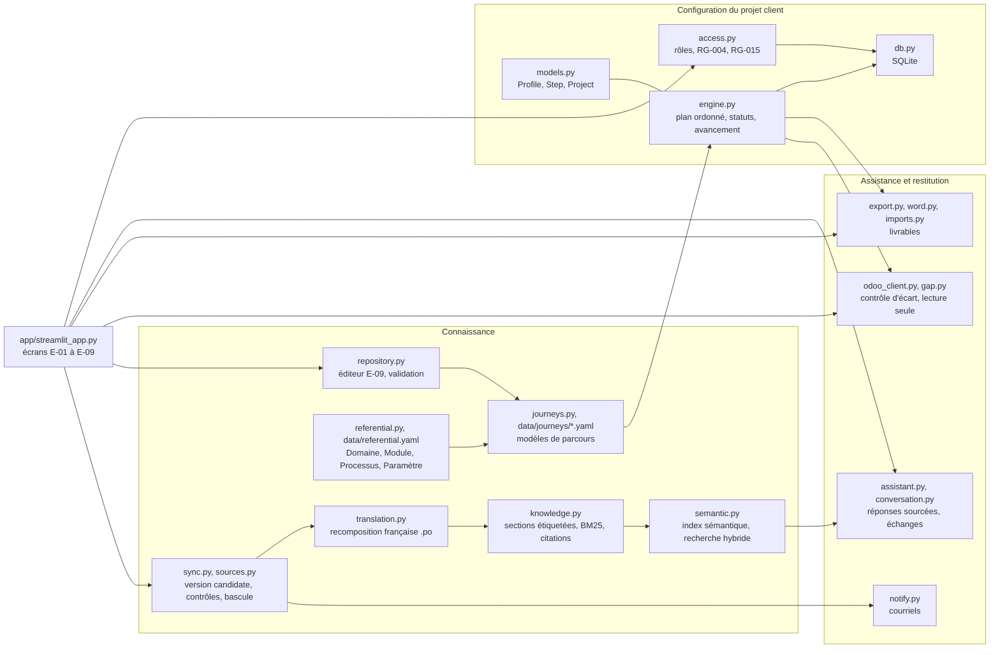

# Architecture

L'application réalise la SFD ([SFD.md](SFD.md)), V1 et phase 2, pour Odoo 18. Elle reprend les
trois couches du schéma fonctionnel (2.1.3) : Connaissance, Configuration du projet client,
Assistance et restitution, servies par l'administration et les intégrations. La correspondance
exigence par exigence est dans [couverture.md](couverture.md).

## Modules

## Flux

1. **Synchronisation** (`sync.py`) : clone partiel de la branche 18.0 (pages RST et traductions
   françaises) en version candidate ; comparaison page par page avec la version active
   (empreinte SHA-256 conservée dans l'index) ; recomposition française et étiquetage des sections
   (application, pays, modules, menus) ; index BM25 et vecteurs sémantiques construits à part ;
   contrôles ERR-001 à ERR-008 ; bascule atomique (`os.replace`) et archivage ; compte rendu et
   notifications. Hebdomadaire (workflow `Doc sync`), manuelle (écran Sources) ou au premier
   démarrage.
2. **Projet** : le consultant crée le projet, affecte les membres, renseigne le profil avec le
   client ; `engine.generate_plan` filtre les parcours et étapes applicables (profil, édition),
   puis les trie par prérequis.
3. **Exécution** : la fiche étape guide le paramétrage ; `access.change_status` applique les
   règles de rôle (RG-004) puis du moteur (RG-003) ; les validations sont notifiées.
4. **Assistance** : la question est posée dans le contexte de l'étape ouverte et de la version du
   projet ; l'échange est conservé avec ses citations et le commit (RG-008).
5. **Livrables** : cahier Excel et Word, checklist, modèles d'import, à l'identité de
   l'organisation (RG-013).
6. **Phase 2** : lecture seule de l'instance du client et contrôle de chaque étape.

## Choix techniques

| Sujet | Choix | Raison |
| --- | --- | --- |
| Référentiel et parcours | YAML livré, validé par pydantic ; modifications du référent enregistrées en base comme fichiers entiers, revalidées avec tout le référentiel | relu comme du code, versionnable (export .zip), aucune modification invalide enregistrée (RG-012) |
| Ordre des étapes | tri topologique stable (Kahn) | ordre du YAML conservé à contrainte égale, cycles détectés |
| Base de données | SQLite (bibliothèque standard), un fichier | aucun serveur à installer ; chemin `OCA_DB` |
| Authentification | comptes locaux, mots de passe PBKDF2 ; OIDC optionnel via `st.login` | la SFD rend le fournisseur d'identité optionnel (Q-009) |
| Recomposition française | remplacement des blocs RST dont le texte est exactement le `msgid` | ne jamais attribuer une traduction au mauvais passage ; le reste en anglais avec mention |
| Recherche | BM25 + analyse sémantique latente (SVD randomisée, numpy), fusion par rang | aucune clé d'API ; sections bilingues donc recherche translingue ; RG-006 reste lexical |
| Éditions (Q-008) | modules requis par étape comparés au dépôt public odoo/odoo 18.0 | vérifiable sans accès au code Enterprise |
| Synchronisation | index candidat à part, bascule par renommage atomique | la version active n'est jamais modifiée en place (RG-009) |
| Modèles d'import | colonnes vérifiées contre les champs déclarés dans le code Community 18.0 | aucun en-tête inventé |
| Messagerie | SMTP de l'organisation, mot de passe en variable d'environnement, journal | pas de secret en base ; trace même sans serveur |
| Contrôle d'écart | API externe XML-RPC, liste fermée de méthodes de lecture | RG-016 garanti côté client, avant tout envoi |
| Modèle de langage | optionnel, Claude, réponse rejetée si elle ne cite aucun extrait | les extraits restent la seule source (Q-002) |
| Interface | Streamlit, un onglet par écran de la SFD, filtrés par rôle | une seule commande pour lancer, déployable sur Community Cloud |

## Vérification du contenu

Les parcours sont vérifiés contre la documentation par `tests/test_journeys_data.py` : pour chaque
étape, le fichier source existe, l'ancre citée est déclarée dans la page, le titre correspond à la
page, le chemin de menu figure tel quel dans une source citée, et l'URL publique correspond au
chemin RST. Les modules requis et les colonnes des modèles d'import sont vérifiés contre le code
Community (`data/editions.json`, `data/odoo_fields.json`). Le job CI `docs-truth` exécute ces
tests sur un clone frais. Une valeur qui n'est pas confirmée par la documentation porte
`verified: false` et une note ; elle apparaît avec la mention « À confirmer » dans l'interface et
dans les livrables.
