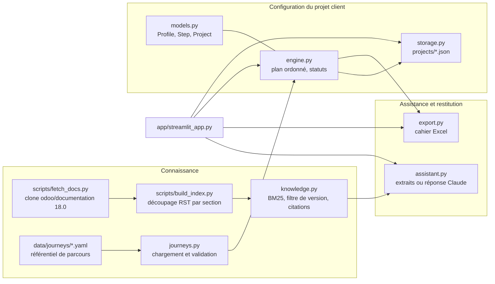

# Architecture de la V0

La V0 est une tranche verticale de la SFD ([SFD.md](SFD.md)) : du profil de l'entreprise au
cahier de paramétrage, pour Odoo 18 et deux parcours (Finance au Québec, Inventaire et
fabrication). Elle reprend les trois couches du schéma fonctionnel de la SFD (2.1.3) :
Connaissance, Configuration du projet client, Assistance et restitution.

## Modules

## Flux principal

1. `fetch_docs.py` clone la branche 18.0 en mode superficiel et enregistre le commit.
2. `build_index.py` découpe les pages RST de finance, inventory_and_mrp et des pages citées par
   les parcours en sections (une unité indexée par titre RST, avec son ancre), puis écrit
   `index/odoo-18.0.json`.
3. Le consultant saisit le profil ; `engine.generate_plan` filtre les parcours et étapes
   applicables, puis les trie par prérequis.
4. La fiche étape affiche l'objectif, le chemin de menu, la valeur recommandée selon le profil,
   les prérequis et les sources ; les changements de statut passent par `engine.set_status`.
5. L'assistant cherche dans l'index de la version du projet et répond avec citations.
6. `export.py` produit le cahier de paramétrage.

## Choix techniques

| Sujet | Choix V0 | Raison | Évolution prévue (SFD) |
| --- | --- | --- | --- |
| Référentiel | YAML validé par pydantic | lisible et revu comme du code, validé au chargement (RG-012) | éditeur de parcours (E-09), base de données |
| Ordre des étapes | tri topologique stable (Kahn) | ordre du YAML conservé à contrainte égale, cycles détectés | inchangé |
| Prérequis hors plan | ignoré pour RG-003, signalé sur la fiche | un prérequis non applicable au profil ne doit pas bloquer | inchangé |
| Recherche | BM25 écrit dans `knowledge.py`, sans dépendance | aucune clé d'API, résultats explicables, testable hors ligne | recherche sémantique derrière l'interface `Retriever` |
| Langue des extraits | pages RST anglaises, glossaire de termes FR vers EN pour la requête | la recomposition depuis les .po est hors V0 | recomposition française (F-003), libellés de menus traduits |
| Seuil de couverture (RG-006) | score BM25 minimal et nombre de termes trouvés | refuser plutôt qu'inventer | seuil calibré sur un jeu de questions types |
| Modèle de langage | optionnel, `claude-opus-5-5`, réponse rejetée si elle ne cite aucun extrait | les extraits restent la seule source | choix du service à arbitrer (Q-002) |
| Persistance | un fichier JSON par projet, écriture atomique | pas de serveur à installer | base de données applicative |
| Interface | Streamlit | une seule commande pour lancer la démo | application web multi-utilisateur avec rôles |

## Vérification du contenu

Les parcours sont vérifiés contre la documentation par `tests/test_journeys_data.py` : pour chaque
étape, le fichier source existe, l'ancre citée est déclarée dans la page, le titre correspond à la
page, le chemin de menu figure tel quel dans une source citée, et l'URL publique correspond au
chemin RST. Le job CI `docs-truth` exécute ces tests sur un clone frais. Une valeur qui n'est pas
confirmée par la documentation porte `verified: false` et une note ; elle apparaît avec la mention
« À confirmer » dans l'interface et dans le cahier.

## Correspondance avec la SFD

| SFD | V0 |
| --- | --- |
| F-002, F-003 Sources et indexation | `fetch_docs.py`, `build_index.py` (sans planification ni recomposition française) |
| F-005 Modèles de parcours | `data/journeys/*.yaml`, `journeys.py` |
| F-007, F-008 Profil et plan | onglet Profil, `engine.py` |
| F-009, F-011 Exécution et suivi | onglets Plan et Fiche étape |
| F-010 Assistant | onglet Assistant, `assistant.py`, `knowledge.py` |
| F-012 Livrables | onglet Export, `export.py` (cahier de paramétrage) |
